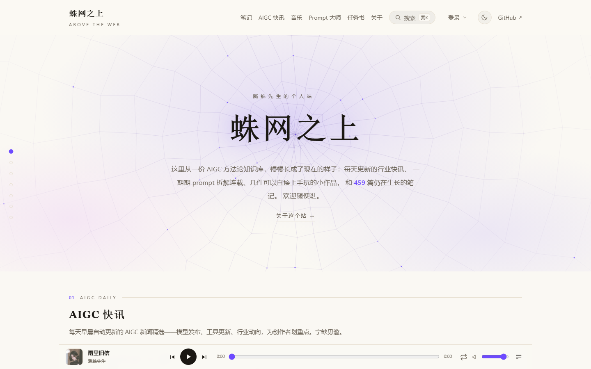
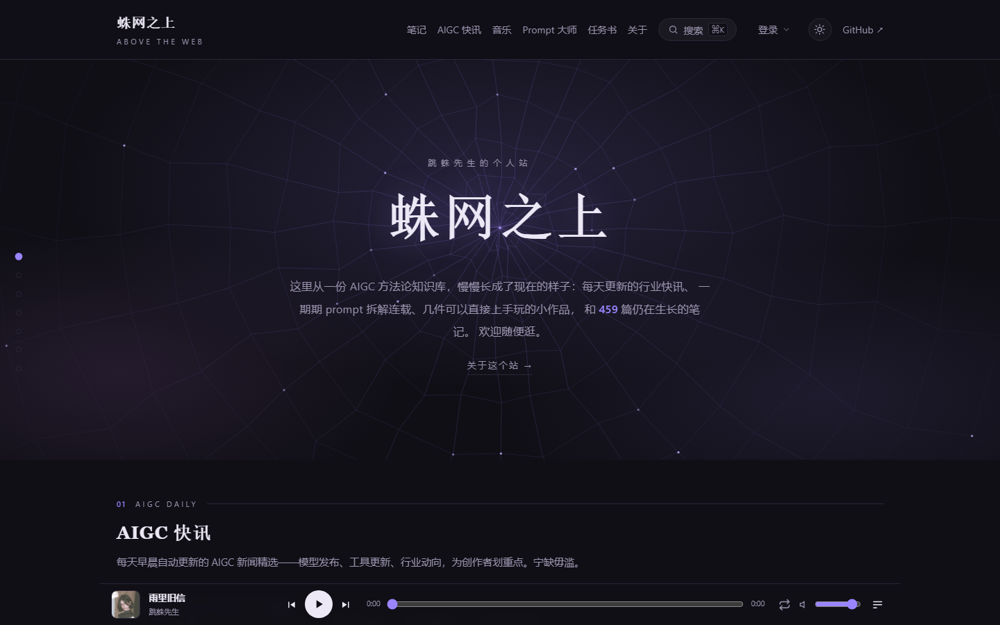
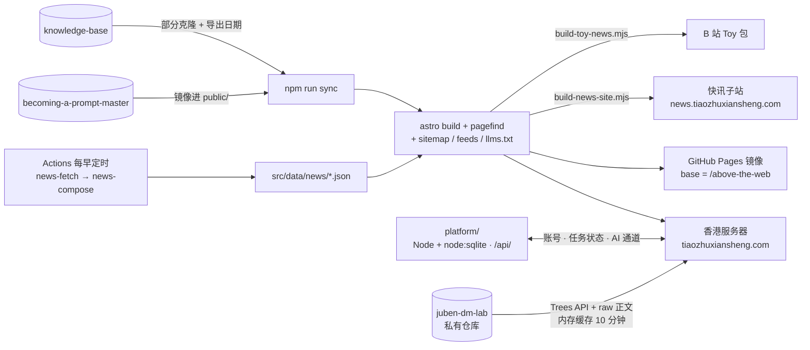

<div align="center">


# 蛛网之上 · Above the Web

**跳蛛先生的杂志风个人站** — 笔记 · AIGC 快讯 · Prompt 拆解连载 · 剧本杀研究室 · 可玩 · 音乐

简体中文 · [English](docs/README_EN.md) · [日本語](docs/README_JA.md)

[](https://github.com/Mr-Salticidae/above-the-web/actions/workflows/deploy.yml)
[](https://github.com/Mr-Salticidae/above-the-web/actions/workflows/aigc-daily-news.yml)


[](LICENSE)
[](https://github.com/Mr-Salticidae/knowledge-base/blob/main/LICENSE.md)

[主站](https://tiaozhuxiansheng.com/) · [GitHub Pages 镜像](https://mr-salticidae.github.io/above-the-web/) · [快讯子站](https://news.tiaozhuxiansheng.com/) · [关于本站](https://tiaozhuxiansheng.com/about/)

</div>

<p align="center">
  
  
</p>

## 这是什么

把一份 Obsidian 创作知识库搬上网，再让它长成一本每天都在更新的杂志。站上有两条并行的主线：

- **AIGC 创作线**——用 AI 做图像、视频、音乐时，哪些经验值得留下、哪些工具值得关注、哪些东西可以直接拿去玩。
- **剧本杀研读线**——一个带本的人怎么把剧本拆开：开本流程、角色动机、线索链、结局分支。公开页只给结构和玩法，谜底锁在邀请制的 DM 档案库里。

四条硬约束贯穿始终：

- **读站不需要账号**，页面里没有统计脚本和广告。登录是为了进 DM 档案库（那头是剧透），或对着知识库追问。
- **静态优先**。能在构建期算好的都在构建期算好（笔记、快讯、播放列表、关于页的计数）；只有账号、任务状态与剧本正文走服务端。
- **剧透隔离**。答案、组织者手册、结局解析只存在私有仓库 `juben-dm-lab`，服务端鉴权后按需下发；公开页与搜索索引里永远没有谜底。
- **国内直连**。香港服务器是主入口，桌面小工具的安装包也从这里直发，不走网盘。

## 站上有什么

| 版块 | 路径 | 内容从哪来 | 一句话 |
| --- | --- | --- | --- |
| 笔记 | `/notes/` | 构建时部分克隆 [knowledge-base](https://github.com/Mr-Salticidae/knowledge-base)，按 `src/lib/kb.mjs` 的 `SELECTED` 白名单发布 7 个栏目 | 方法论、prompt 模板、sref 与参数档案；Obsidian `[[双链]]` 渲染成站内链接，带反向链接 |
| AIGC 快讯 | `/news/` | `src/data/news/YYYY-MM-DD.json`，GitHub Actions 每早自动生成 | 一天一期，每条附来源直达；另打一份发给学员的子站 |
| 成为 Prompt 大师 | `/prompt-master/` | 构建时镜像 [becoming-a-prompt-master](https://github.com/Mr-Salticidae/becoming-a-prompt-master) 进 `public/` | 面向小白的 prompt 拆解连载，每期一个 battle 主题 |
| 可玩 | 首页 `#plays` | `src/data/games.js` + `public/<作品>/` 落地页 | vibe coding 小作品：在线可玩，或免费下载的 Windows 小工具 |
| 音乐 | `/music/` | `src/data/music/manifest.json`；音频存服务器 `/music/` | AI 协作创作的歌，全站底部有播放器 |
| 剧本研究室 | `/juben/` | 公开元数据在 `src/data/juben.js`；DM 档案库由服务端从私有 `juben-dm-lab` 按需拉取 | 可搜索筛选、记录学习进度、复述自测与跨本结构对比；持邀请码的 DM 另开一套完整拆解档案（开本流程、角色剧本、线索、结局） |
| 任务书 | `/tasks/` | `src/data/tasks/*.md`，或管理台直接新建；状态归数据库 | **暂时收起**：上一份工作的遗留，导航与首页都不再出现，直连给一页说明；数据、接口、管理台原样留着 |
| 关于 | `/about/` | 页面本身；各版块的计数构建期现算 | 站长、规矩、时间线、制作说明、许可与联系方式 |

站内还有 Pagefind 全文搜索、知识库 AI 查询（查笔记小助手「小织」）、账号中心与管理台。订阅走 [RSS](https://tiaozhuxiansheng.com/rss.xml) / [JSON Feed](https://tiaozhuxiansheng.com/feed.json)，也可以分栏订阅笔记或快讯。完整路由表见 [docs/PROJECT_MAP.md](docs/PROJECT_MAP.md)。

## 架构一览



- **静态主站**：Astro 5 文件系统路由 + Content Collections（笔记、任务书）。`remark-wikilink` 在构建期把 `[[双链]]` 解析成站内链接，`remark-safe-images` 先把破损图片中性化。
- **内容时间线**：同步时从知识库 git 历史导出每篇笔记的发布 / 更新日期（文件名日期优先），文章页、Feed、Sitemap 共用。
- **分发层**：每页规范地址回指主站、Open Graph、JSON-LD 结构化数据；构建期生成 sitemap.xml、三份 RSS + JSON Feed、robots.txt、llms.txt 与 PWA manifest，零新增依赖。
- **阅读与导航**：文章页吸顶目录与滚动高亮、标题锚点、Shiki 昼夜双主题代码块、阅读时长、相关笔记；跨文档 View Transitions 切页动画 + Speculation Rules 悬停预渲染。
- **搜索**：Pagefind 在构建后为 `dist/` 生成静态索引，零后端；顶栏、页脚、播放器等站点框架不进索引。
- **知识库 AI 查询**：Pagefind 先找相关笔记，登录用户再通过站内 AI 通道获得带原文引用的多轮回答。
- **DM 剧本档案**：正文不进公开仓库。服务端持一枚只读 token，走 GitHub Trees API 取 `juben-dm-lab` 的目录树、按需取 raw markdown，按 DM 阅读顺序分组后下发给客户端，内存缓存 10 分钟（`ATW_JUBEN_CACHE_TTL_MINUTES` 可调）。token 缺失时通道优雅降级——档案库显示「未配置」，邀请码与站内其余部分照常。
- **账号与任务流转**：`platform/`，零第三方依赖的 Node 服务，跑在香港服务器，nginx 反代到 `tiaozhuxiansheng.com/api/`。
- **三种构建变体**：主站（默认）、`TOY_NEWS=1`（B 站 Toy 包）、`NEWS_SITE=1`（快讯子站）。后两种只带快讯，导航改指线上主站的绝对地址。

## 快速开始

需要 Node 22（`.nvmrc` 已固定）、npm、git，以及能访问 GitHub（内容同步要克隆两个公开仓库）。

```bash
npm ci
```

```bash
npm run dev
```

| 命令 | 作用 |
| --- | --- |
| `npm run dev` | 先 `sync` 再起 dev server，默认 `http://localhost:4321/above-the-web/` |
| `npm run dev:nosync` | 跳过内容同步，离线也能改样式 |
| `npm run sync` | 部分克隆或更新 `knowledge-base` 到 `kb-content/`、从 git 历史导出笔记日期到 `.cache/kb-dates.json`、清洗 frontmatter BOM、镜像 Prompt 大师到 `public/prompt-master/`（都已 gitignore） |
| `npm run build` | sync → stamp（内嵌资源按内容哈希加 `?v=`） → `astro build`（含 sitemap / feeds / llms.txt） → Pagefind 索引 |
| `npm run preview` | 本地预览 `dist/` |
| `npm test` | `node --test` 纯逻辑单元测试；CI 里挂了就不出包 |
| `cd platform/server && npm test` | 账号与任务服务的流转回归（注册登录、认领交付、重置密码、限流、AI 配额）；不过就不部署 |

账号、任务认领、管理台这类动态功能要另起 API：

```bash
cd platform/server && npm run dev
```

默认监听 `127.0.0.1:3200`，首次启动会建管理员账号。本地运行与部署的完整说明在 [docs/LOCAL_RUN_AND_DEPLOYMENT.md](docs/LOCAL_RUN_AND_DEPLOYMENT.md)。

构建期环境变量：

| 变量 | 默认 | 说明 |
| --- | --- | --- |
| `BASE_PATH` | `/above-the-web` | 站点子路径；香港服务器构建设为 `/` |
| `SITE_URL` | `https://mr-salticidae.github.io` | 站点根域，生成 canonical 等绝对地址 |
| `PUBLIC_ATW_API` | 空 | 账号 API 地址（含 `/api`，本地调试填 `http://127.0.0.1:3200/api`）；不设时前端回落到主域 `/api/` |
| `PUBLIC_TASKS_ENABLED` | 关 | 任务书版块的开关。默认收起；传 `1` 恢复导航、首页速览与详情页，`/tasks/` 也就不再是暂停说明页 |
| `TOY_NEWS` / `NEWS_SITE` | 空 | 置 `1` 进入对应的只带快讯的构建变体（由脚本设置，一般不用手动传） |

## 仓库结构

```text
.
├─ src/
│  ├─ pages/            路由：首页、notes、news、music、tasks、account、admin、about
│  ├─ layouts/          BaseLayout（顶栏 / 页脚 / 昼夜主题 / 三种构建变体）
│  ├─ components/       SEO 页头、搜索、账号菜单、播放器、快讯期刊、知识库对话、蛛网背景
│  ├─ lib/              构建期数据层：kb / notes / news / prompt-master / remark 插件 / 日期 / feed / sitemap / 结构化数据
│  ├─ integrations/     本地 Astro 集成（构建后生成 sitemap.xml）
│  ├─ scripts/          浏览器端脚本：账号、任务注水、播放器、滚动渐现、AI 辅助、文章页增强
│  ├─ data/             news/ 期刊 JSON · tasks/ 任务书 md · games.js · juben.js · music/manifest.json
│  └─ styles/global.css 设计 token 与全局样式
├─ public/              静态资源与可玩作品落地页（fraud-desk、desk-pond、livelink …）
├─ scripts/             sync-content · stamp-assets · news-fetch · news-compose · build-news-site · build-toy-news
│                       collect-music · upload-music · music-manifest · make-brand-assets
├─ platform/            账号与任务流转服务（server/）与服务器部署脚本（deploy/）
├─ docs/                项目文档：大写下划线命名，首行标最后更新日期（含本 README 的英文、日文版）
├─ test/                node --test 单元测试
├─ .github/workflows/   deploy · deploy-platform · aigc-daily-news · toy-news-update · music-inbox · nginx-site
└─ LICENSE              站点源码的 MIT 许可
```

## 内容与自动化

### 笔记：自动同步自知识库

`scripts/sync-content.mjs` 以 blobless 方式部分克隆 `knowledge-base`（全量提交历史、按需取文件，体积与浅克隆相当），只发布 `SELECTED` 白名单里的栏目：方法论与洞察 / prompt模板库 / sref档案 / 参数行为档案 / 视觉系统 / skill存档 / 平台工程。同步时顺带从 git 历史导出每篇笔记的发布 / 更新日期（文件名以 `YYYY-MM-DD` 开头的以文件名为准）。

站点在以下时机重建部署：本仓库 push、每 6 小时定时、手动 `workflow_dispatch`、`knowledge-base` 发来的 `repository_dispatch`（type `kb-updated`）。

要让 knowledge-base 一更新就秒级同步（可选，一次性配置）：

1. 建一个有 `repo` 权限的 PAT，加到 `knowledge-base` 仓库 secret `DISPATCH_TOKEN`。
2. 在 `knowledge-base` 加 workflow，push 时调用本仓库的 `repository_dispatch`（event_type `kb-updated`）。

未配置时，定时 + push 已能保证同步，只是不即时。

### AIGC 快讯：每天早晨云端自动出刊

- `.github/workflows/aigc-daily-news.yml` 一天四枪错峰 cron 互为重试（GitHub schedule 在整点高峰会延迟甚至丢弃）；当日期刊已存在则几秒空跑，幂等。
- `scripts/news-fetch.mjs` 纯 Node 抓多个 RSS 源产出候选（零 API 成本）→ `scripts/news-compose.mjs` 一次结构化输出调用完成选稿与中文摘要。URL 由脚本从候选表回填，模型只输出候选 id，无从编造链接。
- 模型走 OpenAI 兼容协议，当前是 DashScope 的 `qwen3.8-max`；换供应商只改 `NEWS_API_BASE` / `NEWS_MODEL`，前提是对方支持 `response_format.json_schema`。
- 单次成本从早期 agentic 方案的约 7 美元降到约 0.1 美元。
- 想先看效果再决定发不发：手动触发 workflow 并勾选 `dry_run`。

### 快讯的两份副本

- **子站** `news.tiaozhuxiansheng.com`：`scripts/build-news-site.mjs` 用哨兵 base 另打一份根路径产物 `dist-news/`，`NEWS_SITE=1` 下署名换成「GenJi是真想教会你」、整站 `noindex`、不渲染任何通往个人站的导航。脚本自带守卫：产物里一旦出现自家链接就构建失败。主站 `/news/` 是原件，canonical 自指。
- **B 站 Toy**：`scripts/build-toy-news.mjs` 打成相对路径的独立包，`toy-news-update.yml` 每天 12:30 在当天有新期刊时重传送审。

### 可玩与音乐

- 新增一件可玩作品 = 在 `src/data/games.js` 开头加一条，落地页放 `public/<slug>/`。桌面应用的安装包不进 git、不进 Pages：`deploy.yml` 从各自仓库的最新 Release 抓取，随 `dist/` 一起 rsync 到香港服务器直连下载。
- 音乐：曲目元数据在 `src/data/music/manifest.json`，构建期导出 `/music/playlist.json` 给全站播放器；音频不进 git，放在服务器 `/music/`。上架有两条路：
  - 有服务器私钥的电脑：`collect-music.mjs` 从散落的创作目录把歌归拢进 `music-library/` → `upload-music.mjs` 上传并逐个回查 → `music-manifest.mjs` 生成清单初稿。
  - 没有私钥的电脑：把音频传到 Release `music-inbox`，手动跑 `music-inbox.yml`，由 CI 转码、上传、核对并清理附件（仓库公开，附件在搬走前人人可下载，只放决定上架的歌）。

### 剧本研究室：公开索引与 DM 档案库

同一个剧本在站上分两层放，中间隔着一道邀请制：

| 层 | 谁能看 | 有什么 | 从哪来 |
| --- | --- | --- | --- |
| 公开索引 `/juben/` | 任何人 | 剧本条目、类型、人数、时长、难度、五维评分、学习清单与本机进度 | `src/data/juben.js`，构建期渲染，无答案剧透 |
| DM 档案库 `/juben/`（登录后） | 持邀请码的 DM | 开卷总览、对外学习包、角色剧本、线索卡、组织者手册、音视频转写、结局解析 | 服务端从私有 `juben-dm-lab` 按需拉取 |

- **身份是传出来的**：每位 DM 有一枚常驻邀请码（`dm_invites`），兑换即升级为 `dm` 角色，`users.invited_by` 记下是谁带进来的。第一位 DM 是站长本人；`admin` 天然拥有 DM 权限，不需要兑换。
- **两种邀请码别混**：注册邀请码解决「能不能开号」（`meta.requiresInvite` 控制），DM 邀请码解决「能不能看谜底」。后者在剧本研究室里兑换，与注册流程互不相干。
- **正文只经服务端**：客户端不接触 `juben-dm-lab`。服务端用只读 token 取目录树、按需读 raw markdown，再按 DM 的阅读顺序分组下发（开卷 · 总览 / 对外学习包 / 角色剧本 / 线索卡 / 开本资料…），分册按「第一册…第五册」排序，中文目录名与嵌套路径都按原样保留。
- **配置**：给本仓库加 secret `JUBEN_REPO_TOKEN`（fine-grained PAT，只授 `juben-dm-lab` 的 `Contents: Read`），`deploy-platform.yml` 会把它合并进服务器 `.env` 的 `ATW_JUBEN_TOKEN`。不配也能上线，只是档案库显示「内容通道未配置」。

## 部署

同一次 `deploy.yml` 产出三个目标：

| 目标 | 地址 | 构建参数 | 落点 |
| --- | --- | --- | --- |
| GitHub Pages 镜像 | `mr-salticidae.github.io/above-the-web/` | 默认 | 强制推送到 `gh-pages` 分支（Pages 从分支发布） |
| 香港服务器（国内主入口） | `tiaozhuxiansheng.com` | `BASE_PATH=/` `SITE_URL=https://tiaozhuxiansheng.com` | rsync 到 `/var/www/tiaozhuxiansheng/` |
| 快讯子站 | `news.tiaozhuxiansheng.com` | `build-news-site.mjs` | rsync 到 `/var/www/atw-news/` |

香港 job 还会顺手镜像 `mirror-life-rehearsal-preview` 到 `/mlr/`、`typhoon-eye` 到 `/typhoon-eye/`，并抓取 desk-pond 与 livelink 的最新安装包。

主站 nginx 的自定义 404、`.webmanifest` 类型与 `gzip_types` 写在 `platform/deploy/nginx-site-static.conf`，用手动工作流 `nginx-site.yml` 接入：`inspect` 只读查看，`apply` 备份 → 写入 → `nginx -t` → reload，任一步失败自动回滚。

账号服务单独走 `deploy-platform.yml`：`platform/**` 有改动就先跑流转回归测试，过了再 rsync 到 `/opt/atw-platform/` 并重启 systemd 服务。

仓库需要的 secrets：

| Secret | 用途 |
| --- | --- |
| `HK_HOST` | 香港服务器地址（IP 或域名）。放 secret 而不写死在工作流里，Actions 日志中自动打码；fork 后换成自己的服务器即可 |
| `HK_SSH_KEY` | 香港服务器的部署私钥（主站、子站、账号服务共用） |
| `DASHSCOPE_API_KEY` | 每日快讯的选稿与摘要模型 |
| `TOY_SESSION` | B 站 Toy CLI 的登录态（`~/.toy/session.json` 原文） |
| `JUBEN_REPO_TOKEN` | DM 档案库的只读令牌：fine-grained PAT，只授 `juben-dm-lab` 的 `Contents: Read`。部署时注入 `ATW_JUBEN_TOKEN`；未配置时档案库降级为「未配置」 |

## 账号：读者与 DM

读站、看快讯、逛剧本公开区永远不需要账号。要登录的只有两件事：进 DM 档案库（那头是剧本的谜底），以及对着知识库追问「小织」。

**三种身份**

| 角色 | 对外叫法 | 能做什么 |
| --- | --- | --- |
| `member` | 读者 | 笔记全文搜索、AI 追问、分栏订阅；开号即得，不需要任何码 |
| `dm` | DM | 上面全部，加上完整剧本档案（开本流程、角色剧本、线索、结局） |
| `admin` | 发布方 | 管理台；天然拥有 DM 权限，不需要兑换 |

DM 身份靠人传人：每位 DM 有一枚常驻邀请码，兑换后可以在剧本研究室的侧栏或个人中心复制，继续往下传。

**注册是两步**：先选来意（「我只是来读」/「我有 DM 邀请码」），再填表。选 DM 那条路会多一个邀请码字段，注册成功立刻兑换，直接落进档案库；码没通过也不算注册失败——账号已经建好，人会落在兑换表单上重试，页面会说清是哪一步没过。

- 登录 `/account/login/`、注册 `/account/register/`、个人中心 `/account/`。本机可同时留几个账号，切换不用重输密码；个人中心能看登录设备、单独踢掉某一处。
- 个人中心首屏按身份分流：DM 看到「我的档案库」（本机学习进度、邀请码），读者看到能去哪、怎么拿邀请码。联系方式与收款方式收进折叠的「合作资料」，不再挡路。
- 忘记密码走 `/account/forgot/`：一次性链接 60 分钟有效、用过即焚。发信通道未配时自动退回「管理台生成链接、站长人工发」。
- API 只有一套（`tiaozhuxiansheng.com/api/`）。Pages 镜像跨域也能用，只是两个域的登录态各自独立。

## 任务书：存档待用

任务书是对外发布合作任务、认领、交付与按月对账打款的那一套，属于上一份工作的遗留，目前不作为站点主体。关掉之后它从导航、首页、个人中心、`llms.txt` 里一起消失，`/tasks/` 直连只给一页说明，详情页不再生成（深链接 404），sitemap 因为页面自带 `noindex` 自动跳过。

代码、数据、接口、管理台、月度对账都原样留着，`src/data/tasks/*.md` 也还在。要恢复只需构建时传 `PUBLIC_TASKS_ENABLED=1`，或把 `src/data/features.js` 的默认值改成 `true`——它是全站唯一的开关，导航、首页速览、关于页版块数、账号中心认领区、注册与登录文案都读它。

任务书的两种来源（`src/data/tasks/*.md` 与数据库里新建的）、状态机、认领与打款流程、月度对账口径都在 [platform/README.md](platform/README.md) 与 [docs/TASK_MONTHLY_REPORT.md](docs/TASK_MONTHLY_REPORT.md)，将来重启前先读一遍。

## 文档

| 文档 | 内容 |
| --- | --- |
| [docs/PROJECT_MAP.md](docs/PROJECT_MAP.md) | 全站路由表与技术框架 |
| [docs/SITE_ARCHITECTURE_UPGRADE.md](docs/SITE_ARCHITECTURE_UPGRADE.md) | 2026-09 架构升级：内容时间线、分发层、文章页、预渲染与视图过渡 |
| [docs/LOCAL_RUN_AND_DEPLOYMENT.md](docs/LOCAL_RUN_AND_DEPLOYMENT.md) | 本地运行、构建与生产部署 |
| [docs/KNOWLEDGE_BASE_AI_QUERY.md](docs/KNOWLEDGE_BASE_AI_QUERY.md) | 知识库 AI 查询的工作机制 |
| [docs/KB_ASSISTANT_PERSONA.md](docs/KB_ASSISTANT_PERSONA.md) | 查笔记小助手「小织」的角色卡 |
| [docs/TASK_AI_ASSIST.md](docs/TASK_AI_ASSIST.md) | 任务书 AI 辅助填写 |
| [docs/MUSIC_PLAYER.md](docs/MUSIC_PLAYER.md) | 音乐板块与全站播放器 |
| [docs/MUSIC_UPLOAD_HANDOFF.md](docs/MUSIC_UPLOAD_HANDOFF.md) | 没有服务器私钥时的批量上歌流程（Release 中转 + music-inbox 工作流） |
| [docs/TASK_MONTHLY_REPORT.md](docs/TASK_MONTHLY_REPORT.md) | 任务书月度产出统计与对账口径 |
| [docs/SECURITY.md](docs/SECURITY.md) | 安全策略：如何私下报告漏洞、范围与仓库侧约定 |
| [docs/postmortem-2026-07-task-admin-home.md](docs/postmortem-2026-07-task-admin-home.md) · [docs/postmortem-2026-07-30-deliverable-link.md](docs/postmortem-2026-07-30-deliverable-link.md) | 任务系统与管理台的两份复盘 |
| [platform/README.md](platform/README.md) | 账号与任务流转服务 |
| [AGENTS.md](AGENTS.md) | 文档规范（放 `docs/`、大写下划线命名、首行标日期） |

建站过程中的踩坑与复盘，发布在站内笔记的[「平台工程」栏目](https://tiaozhuxiansheng.com/notes/?cat=%E5%B9%B3%E5%8F%B0%E5%B7%A5%E7%A8%8B)。

## 致谢

- **X-nian** 贡献了「TK 中英文字幕转换器」。
- **GenJi是真想教会你** 的学员是快讯子站的第一批读者。
- 快讯每条都附来源直达，内容版权归各原始媒体。
- [Astro](https://astro.build/)、[Pagefind](https://pagefind.app/) 让一个人也能把静态站做得像回事。

## 参与与安全

- 发现 bug、想要的功能，直接开 issue；PR 提交前请跑通 `npm test` 与 `platform/server` 的测试。
- 安全问题请不要开公开 issue，按 [docs/SECURITY.md](docs/SECURITY.md) 私下报告。
- 想照着搭一个自己的站：fork 后把 `src/lib/site.mjs` 里的站名、作者与规范域名，`scripts/sync-content.mjs` 里的内容源仓库，以及 `src/lib/kb.mjs` 的栏目白名单换成自己的；构建时用 `SITE_URL` / `BASE_PATH` 指定部署地址，部署 secrets 换成自己的服务器。

## 许可

- **站点源码**以 [MIT](LICENSE) 许可开源：代码、构建脚本、工作流、服务端都可以自由使用、修改与再分发，保留版权声明即可。
- **笔记内容**遵循源仓库的 [CC BY-NC 4.0](https://github.com/Mr-Salticidae/knowledge-base/blob/main/LICENSE.md)：署名、非商业，转载改写请保留作者与仓库链接。
- **快讯摘要**为站内编辑，转载注明「蛛网之上」即可；原文版权归各来源。
- **剧本杀拆解内容不随站点开源**：`juben-dm-lab` 是独立私有仓库，其中的剧本原文、组织者手册与拆解笔记版权归原剧本作者与拆解者，站点只经鉴权后向持邀请码的 DM 提供阅读。fork 本仓库不会得到这些内容，也不应另行收集搬运。
- **不在 MIT 范围内**：站名与标识、「小织」形象图、音乐作品，以及 `public/` 下由他人创作的作品（如 X-nian 的字幕转换器、GenJi 的标识）。fork 时请换成你自己的素材。
