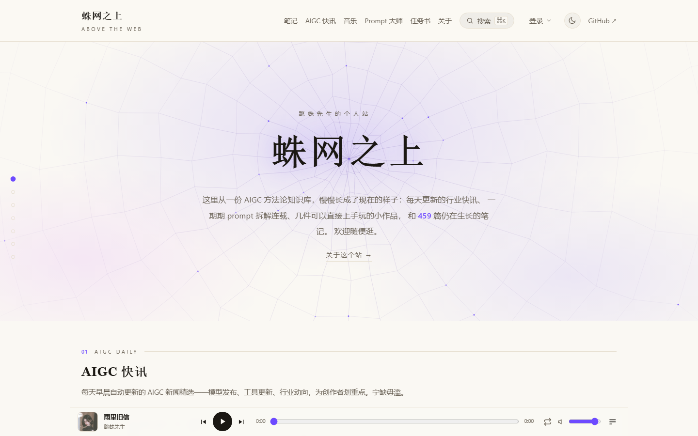
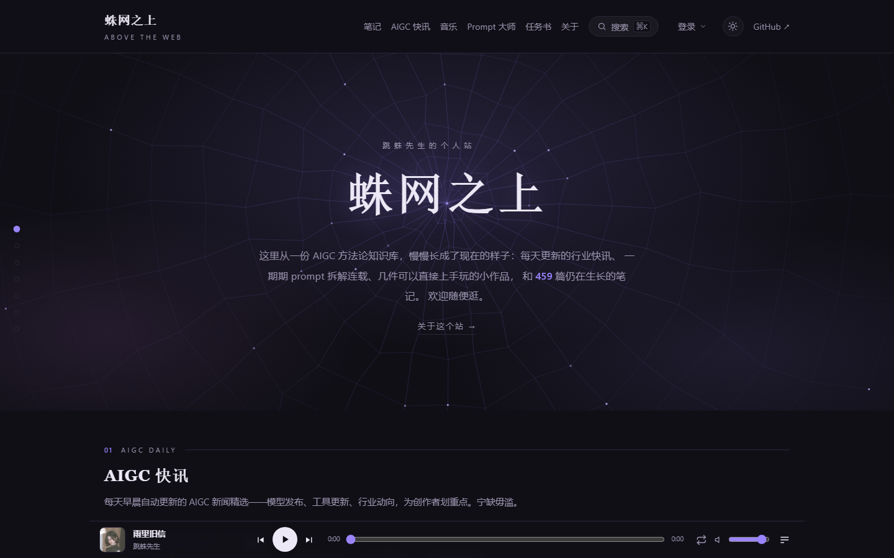
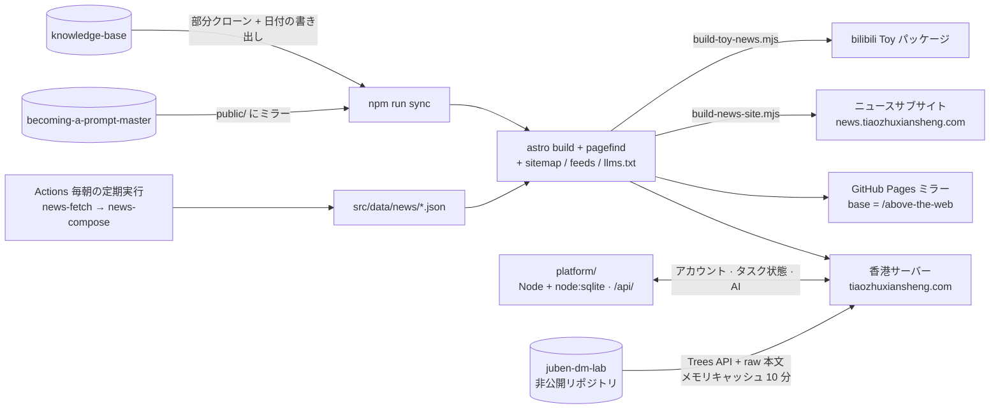

最后更新：2026-09-25

<div align="center">


# 蛛网之上 · Above the Web

**跳蛛先生（ハエトリグモ先生）の雑誌風個人サイト** — ノート · AIGC ニュース · プロンプト分解連載 · マーダーミステリー研究室 · 遊べる作品 · 音楽

[简体中文](../README.md) · [English](README_EN.md) · 日本語

[](https://github.com/Mr-Salticidae/above-the-web/actions/workflows/deploy.yml)
[](https://github.com/Mr-Salticidae/above-the-web/actions/workflows/aigc-daily-news.yml)


[](../LICENSE)
[](https://github.com/Mr-Salticidae/knowledge-base/blob/main/LICENSE.md)

[メインサイト](https://tiaozhuxiansheng.com/) · [GitHub Pages ミラー](https://mr-salticidae.github.io/above-the-web/) · [ニュースサブサイト](https://news.tiaozhuxiansheng.com/) · [このサイトについて](https://tiaozhuxiansheng.com/about/)

</div>

<p align="center">
  
  
</p>

> サイト本体と `docs/` 配下のほかのドキュメントは中国語です。このページは[中国語版 README](../README.md) の翻訳で、内容が食い違う場合は中国語版が正となります。

## これは何か

AI を使った創作についての Obsidian ナレッジベースを Web に載せ、毎日更新される雑誌に育てたものです。サイトには並行する二本の柱があります。

- **AIGC の柱**：AI で画像・動画・音楽を作るとき、どの経験を残す価値があり、どのツールに注目すべきで、何ならそのまま遊べるのか。
- **マーダーミステリーの柱**：ゲームマスターが脚本をどう分解するか。開幕の流れ、登場人物の動機、手がかりの連鎖、結末の分岐。公開ページは構造と遊び方だけで、答えは招待制の DM アーカイブに閉じてあります。

一貫して守っている原則は四つです。

- **読むのにアカウントは不要。** アクセス解析スクリプトも広告もありません。ログインが要るのは依頼書を引き受けるとき（報酬が絡むため）と、DM アーカイブに入るとき（ネタバレが絡むため）だけです。
- **静的ファースト。** ビルド時に計算できるものはすべてビルド時に計算します（ノート、ニュース、プレイリスト、About ページの件数）。サーバーで扱うのはアカウント、タスクの状態、脚本の本文だけです。
- **ネタバレの隔離。** 答え、進行役マニュアル、結末の解説は非公開リポジトリ `juben-dm-lab` にだけ置き、認証を経た DM にだけ必要に応じて配信します。公開ページと検索インデックスには決して含まれません。
- **中国本土から直接つながる。** 香港のサーバーをメインの入口とし、デスクトップ作品のインストーラーもクラウドドライブではなくここから直接配布します。

## サイトの内容

| セクション | パス | コンテンツの出どころ | ひとこと |
| --- | --- | --- | --- |
| ノート | `/notes/` | ビルド時に [knowledge-base](https://github.com/Mr-Salticidae/knowledge-base) を部分クローン。`src/lib/kb.mjs` の `SELECTED` 許可リストで 7 カテゴリを公開 | 方法論、プロンプトテンプレート、sref とパラメーターのアーカイブ。Obsidian の `[[ウィキリンク]]` はサイト内リンクになり、バックリンク付き |
| AIGC ニュース | `/news/` | `src/data/news/YYYY-MM-DD.json`。毎朝 GitHub Actions が自動生成 | 1 日 1 号、各記事に出典リンク付き。受講生向けのサブサイト版も別途ビルド |
| プロンプトマスターへの道 | `/prompt-master/` | ビルド時に [becoming-a-prompt-master](https://github.com/Mr-Salticidae/becoming-a-prompt-master) を `public/` にミラー | 初心者向けのプロンプト分解連載。毎回ひとつの「バトル」テーマ |
| 遊べる作品 | トップページ `#plays` | `src/data/games.js` と `public/<作品>/` のランディングページ | バイブコーディングの小品。オンラインで遊べるもの、無料の Windows ツールなど |
| 音楽 | `/music/` | `src/data/music/manifest.json`。音声ファイルはサーバーの `/music/` に保存 | AI と一緒に作った曲。全ページ下部にプレーヤー |
| マーダーミステリー研究室 | `/juben/` | 公開メタデータは `src/data/juben.js`。DM アーカイブはサーバーが非公開の `juben-dm-lab` から必要に応じて取得 | 脚本の検索・絞り込み、学習進捗の記録（アカウントに紐づいて端末間で同期）、復唱クイズ、作品をまたいだ構造比較。招待コードを持つ DM には開幕の流れ・キャラクター脚本・手がかり・結末まで含む完全版も開く |
| 依頼書 | `/tasks/` | `src/data/tasks/*.md`、または管理画面から新規作成。状態はデータベースで管理 | **いったん休止**：前の仕事の遺産で、ナビゲーションにもトップページにも出なくなりました。URL を直接開くと短い説明だけが出ます。データ・API・管理画面はそのまま残しています |
| About | `/about/` | ページ自体。7 セクションの件数はビルド時に算出 | 運営者、方針、年表、制作メモ、ライセンスと連絡先 |

ほかに Pagefind による全文検索、ノート向け AI アシスタント「小織」、アカウントセンターと管理画面があります。購読は [RSS](https://tiaozhuxiansheng.com/rss.xml) / [JSON Feed](https://tiaozhuxiansheng.com/feed.json) で、ノートやニュースだけを個別に購読することもできます。全ルート表は [PROJECT_MAP.md](PROJECT_MAP.md)（中国語）を参照してください。

## アーキテクチャ



- **静的サイト**：Astro 5 のファイルベースルーティングと Content Collections（ノート、依頼書）。ビルド時に `remark-wikilink` が `[[ウィキリンク]]` をサイト内リンクに解決し、その前に `remark-safe-images` が壊れた画像を無害化します。
- **コンテンツの時系列**：同期時にナレッジベースの git 履歴から各ノートの公開日・更新日を書き出します（ファイル名先頭の日付が優先）。記事ページ、フィード、サイトマップで共通に使います。
- **配信レイヤー**：全ページの canonical はメインサイトを指し、Open Graph と JSON-LD 構造化データを付けます。ビルド時に sitemap.xml、RSS 3 本と JSON Feed、robots.txt、llms.txt、PWA マニフェストを生成し、依存は増やしていません。
- **閲覧とナビゲーション**：記事ページは追従する目次とスクロール連動ハイライト、見出しアンカー、Shiki のライト／ダーク両対応コードブロック、読了時間、関連ノート付き。ページ遷移はドキュメント間の View Transitions、ホバー時は Speculation Rules でプリレンダーします。
- **検索**：ビルド後に Pagefind が `dist/` の静的インデックスを作るので、検索用のバックエンドはありません。ヘッダー、フッター、プレーヤーなどの枠部分はインデックスから除外しています。
- **ノートの AI 検索**：まず Pagefind で関連ノートを探し、ログインユーザーにはサイト内の AI チャネル経由で原文を引用した複数ターンの回答を返します。
- **DM 脚本アーカイブ**：脚本の本文は公開リポジトリに入りません。サーバーが読み取り専用トークンで GitHub Trees API から `juben-dm-lab` のツリーを取得し、必要に応じて raw markdown を読んで DM の閲覧順にグループ化してから配信します。メモリキャッシュは 10 分（`ATW_JUBEN_CACHE_TTL_MINUTES` で調整可）。トークンが無い場合もチャネルは穏当に縮退し、アーカイブは「未設定」を返すだけで、招待コードとサイトの他の部分は通常どおり動きます。
- **アカウントとタスクの流れ**：`platform/` はサードパーティ依存ゼロの Node サービスで、香港サーバー上で nginx 経由 `tiaozhuxiansheng.com/api/` として動いています。
- **3 種類のビルド**：メインサイト（デフォルト）、`TOY_NEWS=1`（bilibili Toy パッケージ）、`NEWS_SITE=1`（ニュースサブサイト）。後の二つはニュースだけを含み、ナビゲーションはメインサイトの絶対 URL を指します。

## クイックスタート

Node 22（`.nvmrc` で固定）、npm、git、そして GitHub へのアクセスが必要です（コンテンツ同期で公開リポジトリを二つクローンするため）。

```bash
npm ci
```

```bash
npm run dev
```

| コマンド | 内容 |
| --- | --- |
| `npm run dev` | `sync` を実行してから開発サーバーを起動。デフォルトは `http://localhost:4321/above-the-web/` |
| `npm run dev:nosync` | コンテンツ同期を飛ばすので、オフラインでもスタイルを調整できる |
| `npm run sync` | `knowledge-base` を `kb-content/` に部分クローンまたは更新し、git 履歴からノートの日付を `.cache/kb-dates.json` に書き出し、frontmatter の BOM を除去し、プロンプトマスターを `public/prompt-master/` にミラー（いずれも gitignore 済み） |
| `npm run build` | sync → stamp（埋め込みアセットにコンテンツハッシュの `?v=` を付与） → `astro build`（sitemap / feeds / llms.txt を含む） → Pagefind インデックス |
| `npm run preview` | `dist/` をローカルでプレビュー |
| `npm test` | `node --test` による純ロジックの単体テスト。CI で失敗するとリリースされない |
| `cd platform/server && npm test` | アカウント・タスクサービスのフロー回帰テスト（登録・ログイン、引き受け・納品、パスワード再設定、レート制限、AI 利用枠）。失敗するとデプロイされない |

アカウント、依頼書の引き受け、管理画面などの動的機能には API を別に起動します。

```bash
cd platform/server && npm run dev
```

デフォルトで `127.0.0.1:3200` を待ち受け、初回起動時に管理者アカウントを作成します。ローカル実行とデプロイの詳細は [LOCAL_RUN_AND_DEPLOYMENT.md](LOCAL_RUN_AND_DEPLOYMENT.md)（中国語）にあります。

ビルド時の環境変数：

| 変数 | デフォルト | 説明 |
| --- | --- | --- |
| `BASE_PATH` | `/above-the-web` | サイトのサブパス。香港サーバー向けビルドでは `/` |
| `SITE_URL` | `https://mr-salticidae.github.io` | サイトのオリジン。canonical などの絶対 URL に使う |
| `PUBLIC_ATW_API` | 空 | アカウント API の URL（`/api` まで含める。ローカルは `http://127.0.0.1:3200/api`）。未設定ならフロントエンドはメインドメインの `/api/` を使う |
| `PUBLIC_TASKS_ENABLED` | オフ | 依頼書セクションのスイッチ。既定は休止で、`1` を渡すとナビ・トップページの抜粋・詳細ページが戻り、`/tasks/` も説明ページでなくなる |
| `PUBLIC_PROGRESS_SYNC` | オン | 学習進捗の端末間同期。`0` で従来のローカルのみに戻る（サーバー側 `ATW_PROGRESS_SYNC=0` でも同じ効果、再ビルド不要） |
| `TOY_NEWS` / `NEWS_SITE` | 空 | `1` にすると対応するニュース専用ビルドになる（スクリプトが設定するので、通常は手で渡さない） |

## リポジトリ構成

```text
.
├─ src/
│  ├─ pages/            ルート：トップ、notes、news、music、tasks、account、admin、about
│  ├─ layouts/          BaseLayout（ヘッダー / フッター / ライト・ダークテーマ / 3 種類のビルド）
│  ├─ components/       SEO ヘッダー、検索、アカウントメニュー、プレーヤー、ニュース号、ノートチャット、クモの巣背景
│  ├─ lib/              ビルド時データ層：kb / notes / news / prompt-master / remark プラグイン / 日付 / フィード / サイトマップ / 構造化データ
│  ├─ integrations/     ローカルの Astro インテグレーション（ビルド後に sitemap.xml を生成）
│  ├─ scripts/          ブラウザ用スクリプト：アカウント、タスクのハイドレーション、プレーヤー、スクロール表示、AI 補助、記事ページ拡張
│  ├─ data/             news/ 各号の JSON · tasks/ 依頼書 md · games.js · music/manifest.json
│  └─ styles/global.css デザイントークンとグローバルスタイル
├─ public/              静的アセットと遊べる作品のランディングページ（fraud-desk、desk-pond、livelink …）
├─ scripts/             sync-content · stamp-assets · news-fetch · news-compose · build-news-site · build-toy-news
│                       collect-music · upload-music · music-manifest · make-brand-assets
├─ platform/            アカウント・タスクサービス（server/）とサーバー用デプロイスクリプト（deploy/）
├─ docs/                プロジェクト文書：大文字＋アンダースコアの命名、1 行目は最終更新日（この翻訳も含む）
├─ test/                node --test の単体テスト
├─ .github/workflows/   deploy · deploy-platform · aigc-daily-news · toy-news-update · music-inbox · nginx-site
└─ LICENSE              サイトのソースコードの MIT ライセンス
```

## コンテンツと自動化

### ノート：ナレッジベースから自動同期

`scripts/sync-content.mjs` は `knowledge-base` を blobless で部分クローンします（コミット履歴は全部、ファイルは必要に応じて取得するので、サイズは浅いクローンと同程度）。公開するのは `SELECTED` 許可リストにあるカテゴリだけです：方法论与洞察（方法論と洞察）/ prompt模板库（プロンプトテンプレート）/ sref档案（sref アーカイブ）/ 参数行为档案（パラメーター挙動アーカイブ）/ 视觉系统（ビジュアルシステム）/ skill存档（skill アーカイブ）/ 平台工程（プラットフォームエンジニアリング）。同期時には各ノートの公開日・更新日も git 履歴から書き出します（ファイル名が `YYYY-MM-DD` で始まる場合はそれが優先）。

サイトは、このリポジトリへの push、6 時間ごとの定期実行、手動の `workflow_dispatch`、`knowledge-base` から送られる `repository_dispatch`（type `kb-updated`）のタイミングで再ビルド・デプロイされます。

knowledge-base の更新を数秒で反映させたい場合（任意、一度だけの設定）：

1. `repo` 権限の PAT を作り、`knowledge-base` リポジトリの secret `DISPATCH_TOKEN` に登録する。
2. `knowledge-base` に、push 時にこのリポジトリの `repository_dispatch`（event_type `kb-updated`）を呼ぶワークフローを追加する。

設定しなくても定期実行と push で同期はされます。即時ではないだけです。

### AIGC ニュース：毎朝クラウドで自動発行

- `.github/workflows/aigc-daily-news.yml` は時刻をずらした cron を 1 日 4 回走らせ、互いのリトライにしています（GitHub のスケジューラーは混雑する正時に遅延したりジョブを落としたりするため）。その日の号がすでにあれば数秒で空振りするので冪等です。
- `scripts/news-fetch.mjs` が素の Node で複数の RSS を取得して候補を作り（API コストゼロ）、`scripts/news-compose.mjs` が構造化出力の 1 回の呼び出しで記事選定と中国語の要約を行います。URL はスクリプトが候補表から埋め戻し、モデルは候補 id しか出力しないので、リンクを捏造できません。
- モデルは OpenAI 互換 API 経由で、現在は DashScope の `qwen3.8-max` です。`response_format.json_schema` に対応していれば、`NEWS_API_BASE` / `NEWS_MODEL` を変えるだけで提供元を切り替えられます。
- 1 回あたりのコストは、初期のエージェント方式の約 7 米ドルから約 0.1 米ドルに下がりました。
- 公開前に結果を確認したいときは、ワークフローを手動実行して `dry_run` にチェックを入れます。

### ニュースの 2 つのコピー

- **サブサイト** `news.tiaozhuxiansheng.com`：`scripts/build-news-site.mjs` が番兵 base を使ってルートパスの成果物 `dist-news/` を別にビルドします。`NEWS_SITE=1` では署名が「GenJi是真想教会你」になり、サイト全体が `noindex`、個人サイトへのナビゲーションは一切出しません。スクリプトにはガードがあり、成果物に個人サイトへのリンクが混ざるとビルドが失敗します。原本はメインサイトの `/news/` で、canonical は自身を指します。
- **bilibili Toy**：`scripts/build-toy-news.mjs` が相対パスの独立パッケージを作り、`toy-news-update.yml` が新しい号のある日の北京時間 12:30 に再アップロードして審査に出します。

### 遊べる作品と音楽

- 遊べる作品を追加するには、`src/data/games.js` の先頭にエントリを足し、ランディングページを `public/<slug>/` に置きます。デスクトップアプリのインストーラーは git にも Pages にも入れません。`deploy.yml` が各リポジトリの最新 Release から取得し、`dist/` と一緒に香港サーバーへ rsync して直接ダウンロードできるようにします。
- 音楽：曲のメタデータは `src/data/music/manifest.json` にあり、ビルド時に全ページ共通プレーヤー用の `/music/playlist.json` を書き出します。音声ファイルは git に入れず、サーバーの `/music/` に置きます。追加方法は二つです。
  - サーバーの鍵がある PC：`collect-music.mjs` があちこちの制作フォルダから曲を `music-library/` に集め、`upload-music.mjs` がアップロードしてサーバー上のファイルを一つずつ確認し、`music-manifest.mjs` がマニフェストの下書きを作ります。
  - 鍵がない PC：音声を Release `music-inbox` にアップロードし、`music-inbox.yml` を手動実行します。CI が変換・アップロード・照合を行い、添付ファイルを片付けます。リポジトリは公開なので、移し終えるまで添付ファイルは誰でもダウンロードできます。公開すると決めた曲だけを置いてください。

### マーダーミステリー研究室：公開インデックスと DM アーカイブ

一つの脚本を二層に分けて置き、その間に招待制の扉を挟みます。

| 層 | 読める人 | 中身 | 出どころ |
| --- | --- | --- | --- |
| 公開インデックス `/juben/` | 誰でも | 脚本の項目、ジャンル、人数、所要時間、難易度、五軸評価、学習チェックリストとローカル進捗 | `src/data/juben.js`。ビルド時に描画し、ネタバレなし |
| DM アーカイブ `/juben/`（ログイン後） | 招待コードを持つ DM | 開巻の概要、外向け学習パック、キャラクター脚本、手がかりカード、進行役マニュアル、音声・映像の文字起こし、結末の解説 | サーバーが非公開の `juben-dm-lab` から必要に応じて取得 |

- **身分は人から人へ渡ります。** DM はそれぞれ常設の招待コード（`dm_invites`）を持ち、引き換えると `dm` ロールに昇格し、誰に招かれたかが `users.invited_by` に残ります。最初の DM は運営者本人で、`admin` は DM 権限を最初から持つため引き換えは不要です。
- **二種類の招待コードを混同しないでください。** 登録コードは「アカウントを作れるか」（`meta.requiresInvite` で制御）、DM コードは「答えを読めるか」を決めます。後者は研究室内で引き換えるもので、登録の流れとは無関係です。
- **本文はサーバー経由でのみ流れます。** クライアントは `juben-dm-lab` に触れません。サーバーが読み取り専用トークンでツリーを取得し、必要に応じて raw markdown を読み、DM の閲覧順（開巻・概要 / 学習パック / キャラクター脚本 / 手がかりカード / 開幕資料…）にグループ化して配信します。分冊は「第一冊…第五冊」の順に並べ、中国語のディレクトリ名と入れ子のパスはそのまま保ちます。
- **設定**：このリポジトリに secret `JUBEN_REPO_TOKEN`（`juben-dm-lab` の `Contents: Read` だけを持つ fine-grained PAT）を追加すると、`deploy-platform.yml` がサーバーの `.env` の `ATW_JUBEN_TOKEN` にマージします。未設定でもデプロイは成功し、アーカイブが「未設定」と表示されるだけです。
- **学習進捗の端末間同期**：`src/scripts/progress-sync.js` が通信層で、ストア自身は `fetch` に触れません。チェックはまずローカルに書き、キュー（これも localStorage、アカウント別バケット）に積んで 1.5 秒でまとめて送信します。オフライン・タブを閉じた場合・5xx でも書き込みは失われず、次のチェック／再接続／タブ復帰／バッジのクリックで再送されます。
  - サーバー側は `juben_progress`（1 行 = 利用者 × 卷 × モジュール。チェック解除は `done=0` の墓標で、行は削除しない）と `juben_sync_state`（利用者ごとの自動増分 `rev` を差分カーソルに使い、どの時計も信頼しない）。エンドポイントは `/api/juben/progress` の GET / POST / DELETE。
  - マージは項目ごとの LWW：`client_at` が新しい方が勝ち、同時刻なら `done=1` 優先。受け取る時刻は `[now-30d, now+5m]` に丸めるので、時計を 2030 年にした端末が永久に固定することはできません。
  - プライバシー：トークン本人の行だけを返し、`userId` パラメータは受け付けません。管理画面に他人の進捗を見る機能はなく、監査ログは「消去」だけを記録します。
  - 読者（`member`）も同期できます。モジュール一覧は公開情報で、DM 制限は本文だけに掛かるためです。状態はトーストではなくバッジで常時表示します。
  - 切り戻し：ビルド時の `PUBLIC_PROGRESS_SYNC=0`、またはサーバーの `ATW_PROGRESS_SYNC=0`（フロントは `/api/meta` に従うので、再ビルド不要で環境変数ひとつで止められます）。
- **どこまで読んだか**：同じ items に予約された卷名 `reading`（モジュール位置は `case-<id>`）として保存します。別のストレージも別のプロトコルも要りませんが、その代わりこれらの行は達成率に数えません（`count` / `countAll` はカタログに実在する slug だけを数えます）。同じ卷に十分以内に再入場しても書き直さず、新しい端末では最初のプルが返ってから位置を決めるので、「既定の一巻目」が本当の記録を上書きすることはありません。
- **自測問題の位置**：`atw-juben-quiz` に卷ごとの問題番号をローカル保存のみ。スマホで解いた問題が PC の位置を動かすべきではないためです。
- **ステータスカード**（アカウントセンター「我的档案库」の下）：最終同期・未同期件数・記録された端末数、そして「今すぐ同期」「進捗をすべて消去」。端末数は `COUNT(DISTINCT device_id)` で、id はフロントが生成する乱数（UA も IP も見ません）。消去は二回クリック（一回目は 4 秒だけボタンを武装）で、墓標を書くので他の端末も次回の表示でゼロになります。

### `JUBEN_REPO_TOKEN` のローテーション

fine-grained PAT には有効期限があります（1 年推奨）。期限切れはエラーにならず、アーカイブが静かに「未設定」へ落ちるだけなので、デプロイ時にプライベートリポジトリを確認し、読めない場合は Actions ログに `::warning::` を出すようにしました。

1. [新しい fine-grained token](https://github.com/settings/personal-access-tokens/new) を開き、任意の名前・有効期限 1 年・`Repository access` は `juben-dm-lab` のみ・権限は `Contents: Read` のみ。
2. リポジトリのディレクトリで次を実行し、プロンプトに token を貼り付けます（入力は表示されません）：

```bash
gh secret set JUBEN_REPO_TOKEN -R Mr-Salticidae/above-the-web
```

   変数に入っている場合は、先に接頭辞を確認してください（secret 名の位置に token を渡すと HTTP 422 になります）：

```bash
case "$t" in github_pat_*) gh secret set JUBEN_REPO_TOKEN -R Mr-Salticidae/above-the-web --body "$t";; *) echo "token ではありません";; esac
```

3. `gh workflow run deploy-platform.yml`（または main へ push）を実行し、ログに「トークンが使える」と出ることを確認します。
4. その後 GitHub で古い token を削除します。

## デプロイ

`deploy.yml` の 1 回の実行で 3 つの成果物を出します。

| 対象 | URL | ビルドパラメーター | 配置先 |
| --- | --- | --- | --- |
| GitHub Pages ミラー | `mr-salticidae.github.io/above-the-web/` | デフォルト | `gh-pages` ブランチへ強制 push（Pages はブランチから公開） |
| 香港サーバー（中国本土向けのメイン入口） | `tiaozhuxiansheng.com` | `BASE_PATH=/` `SITE_URL=https://tiaozhuxiansheng.com` | `/var/www/tiaozhuxiansheng/` へ rsync |
| ニュースサブサイト | `news.tiaozhuxiansheng.com` | `build-news-site.mjs` | `/var/www/atw-news/` へ rsync |

香港向けジョブは、ついでに `mirror-life-rehearsal-preview` を `/mlr/` に、`typhoon-eye` を `/typhoon-eye/` にミラーし、desk-pond と livelink の最新インストーラーも取得します。

メインサイトの nginx 設定（カスタム 404、`.webmanifest` の MIME タイプ、`gzip_types`）は `platform/deploy/nginx-site-static.conf` にあり、手動ワークフロー `nginx-site.yml` で適用します。`inspect` は読み取り専用、`apply` はバックアップ → 書き込み → `nginx -t` → reload の順に進み、どこかで失敗すると自動でロールバックします。

アカウントサービスは `deploy-platform.yml` で別にデプロイします。`platform/**` に変更があるとまずフロー回帰テストを走らせ、通った場合だけ `/opt/atw-platform/` に rsync して systemd サービスを再起動します。

リポジトリに必要な secrets：

| Secret | 用途 |
| --- | --- |
| `HK_HOST` | 香港サーバーのアドレス（IP またはドメイン）。ワークフローに直書きせず secret にしているので、Actions のログではマスクされる。フォークしたら自分のサーバーに差し替える |
| `HK_SSH_KEY` | 香港サーバーのデプロイ用秘密鍵（メインサイト、サブサイト、アカウントサービスで共用） |
| `DASHSCOPE_API_KEY` | 毎日のニュースの選定と要約に使うモデル |
| `TOY_SESSION` | bilibili Toy CLI のログインセッション（`~/.toy/session.json` の中身そのまま） |
| `JUBEN_REPO_TOKEN` | DM アーカイブ用の読み取り専用トークン。`juben-dm-lab` の `Contents: Read` だけを持つ fine-grained PAT。デプロイ時に `ATW_JUBEN_TOKEN` として注入され、未設定ならアーカイブは「未設定」を返す |

## アカウント：読者と DM

サイトを読む、ニュースを見る、脚本の公開ページを眺めるのにアカウントは要りません。ログインで得られるのは二つです。DM アーカイブに入る権利（脚本の答えはそこにあります）と、ノートのアシスタント「小織」への追加質問です。

| ロール | 表示名 | できること |
| --- | --- | --- |
| `member` | 読者 | ノートの全文検索、AI への追加質問、欄ごとの購読。コードは不要です |
| `dm` | DM | 上記すべてに加えて、開幕の流れ・キャラクター脚本・手がかり・結末まで含む完全なアーカイブ |
| `admin` | 発注側 | 管理画面。DM 権限を最初から持ち、引き換えは不要です |

DM の身分は人から人へ渡ります。DM はそれぞれ常設の招待コードを一つ持ち、引き換えたあとはマーダーミステリー研究室のサイドバーかマイページからコピーして次の人へ渡せます。

**登録は二段階**です。まず来意を選び（「読むだけ」／「DM 招待コードを持っている」）、それからフォームを埋めます。DM の道では招待コードの欄が増え、アカウント作成と引き換えを一度に行って、そのままアーカイブに入ります。コードが通らなくても登録失敗ではありません。アカウントは作られていて、引き換えフォームに着地し、どこで止まったかが表示されます。

- ログインは `/account/login/`、登録は `/account/register/`、マイページは `/account/`。同じブラウザに複数のアカウントを保持でき、パスワードを入れ直さずに切り替えられます。マイページではログイン中の端末を確認し、個別にログアウトさせられます。
- マイページの概要はロールで変わります。DM にはアーカイブ（この端末の学習進度と招待コード）、読者には行き先とコードの入手方法を表示します。連絡先と支払い先は折りたたんだ「協力資料」の中に入り、画面を塞ぎません。
- パスワードを忘れたら `/account/forgot/` へ。60 分有効で一度使うと無効になるワンタイムリンクを送ります。メール送信サービスが未設定なら「管理画面でリンクを生成し、運営者が手で送る」方式に自動で切り替わります。
- API は一つだけです（`tiaozhuxiansheng.com/api/`）。Pages ミラーからもクロスオリジンで使えますが、二つのドメインのログイン状態は別々です。

## 依頼書：休止中、ただし保存はしている

依頼書（有償タスクの発行・引き受け・納品・月次の照合と支払い）は前の仕事の遺産で、いまはサイトの主体ではありません。休止中はナビゲーション、トップページ、マイページ、`llms.txt` から消え、`/tasks/` は短い説明だけを返し、タスク詳細ページは生成されず（深いリンクは 404）、ページ自体が `noindex` なので sitemap からも外れます。

コード、データ、API、管理画面、月次照合はそのまま残っており、`src/data/tasks/*.md` も無傷です。再開するにはビルド時に `PUBLIC_TASKS_ENABLED=1` を渡すか、`src/data/features.js` の既定値を `true` に変えてください。ナビ、トップページ、About の欄数、マイページ、登録時の文言はすべてこの一つのスイッチを見ています。

サービスのコード、状態遷移、2 種類の依頼書の役割分担、デプロイと運用は [platform/README.md](../platform/README.md)（中国語）にまとめてあります。

## ドキュメント

以下のドキュメントはすべて中国語です。

| ドキュメント | 内容 |
| --- | --- |
| [PROJECT_MAP.md](PROJECT_MAP.md) | 全ルート表と技術構成 |
| [SITE_ARCHITECTURE_UPGRADE.md](SITE_ARCHITECTURE_UPGRADE.md) | 2026 年 9 月のアーキテクチャ刷新：コンテンツの時系列、配信レイヤー、記事ページ、プリレンダーとビュー遷移 |
| [LOCAL_RUN_AND_DEPLOYMENT.md](LOCAL_RUN_AND_DEPLOYMENT.md) | ローカル実行、ビルド、本番デプロイ |
| [KNOWLEDGE_BASE_AI_QUERY.md](KNOWLEDGE_BASE_AI_QUERY.md) | ナレッジベース AI 検索の仕組み |
| [KB_ASSISTANT_PERSONA.md](KB_ASSISTANT_PERSONA.md) | ノートアシスタント「小織」のキャラクター設定 |
| [TASK_AI_ASSIST.md](TASK_AI_ASSIST.md) | 依頼書の AI 入力補助 |
| [MUSIC_PLAYER.md](MUSIC_PLAYER.md) | 音楽セクションと全ページ共通プレーヤー |
| [MUSIC_UPLOAD_HANDOFF.md](MUSIC_UPLOAD_HANDOFF.md) | サーバーの鍵がない PC から曲をまとめて上げる手順（Release 経由 + music-inbox ワークフロー） |
| [TASK_MONTHLY_REPORT.md](TASK_MONTHLY_REPORT.md) | 依頼書の月次集計と照合のルール |
| [SECURITY.md](SECURITY.md) | セキュリティポリシー：脆弱性の非公開での報告方法、対象範囲、リポジトリ側の決まりごと |
| [postmortem-2026-07-task-admin-home.md](postmortem-2026-07-task-admin-home.md) · [postmortem-2026-07-30-deliverable-link.md](postmortem-2026-07-30-deliverable-link.md) | 依頼書システムと管理画面についての振り返り 2 本 |
| [platform/README.md](../platform/README.md) | アカウント・タスクサービス |
| [AGENTS.md](../AGENTS.md) | ドキュメント規約（`docs/` に置く、大文字＋アンダースコアの命名、1 行目に日付） |

サイト構築中にハマったことや振り返りは、サイト内ノートの[「平台工程」（プラットフォームエンジニアリング）カテゴリ](https://tiaozhuxiansheng.com/notes/?cat=%E5%B9%B3%E5%8F%B0%E5%B7%A5%E7%A8%8B)で公開しています。

## 謝辞

- **X-nian** さんが「TK 中英文字幕转换器」（TK 中英字幕変換ツール）を提供してくれました。
- **GenJi是真想教会你** さんの受講生が、ニュースサブサイトの最初の読者です。
- ニュースの各記事には出典リンクを付けています。元記事の著作権は各メディアに帰属します。
- [Astro](https://astro.build/) と [Pagefind](https://pagefind.app/) のおかげで、一人でもまともな静的サイトが作れます。

## 参加とセキュリティ

- バグや欲しい機能があれば issue を立ててください。PR を送る前に `npm test` と `platform/server` のテストが通ることを確認してください。
- セキュリティの問題は公開 issue にせず、[SECURITY.md](SECURITY.md) に沿って非公開で報告してください。
- これを元に自分のサイトを作りたい場合：フォークしたら、`src/lib/site.mjs` のサイト名・著者・canonical ドメイン、`scripts/sync-content.mjs` のコンテンツ元リポジトリ、`src/lib/kb.mjs` のカテゴリ許可リストを自分のものに差し替えてください。デプロイ先はビルド時に `SITE_URL` / `BASE_PATH` で指定し、デプロイ用 secrets は自分のサーバーに向けます。

## ライセンス

- **サイトのソースコード**は [MIT](../LICENSE) ライセンスで公開しています。コード、ビルドスクリプト、ワークフロー、サーバーは、著作権表示を残す限り自由に利用・改変・再配布できます。
- **ノート**は元リポジトリの [CC BY-NC 4.0](https://github.com/Mr-Salticidae/knowledge-base/blob/main/LICENSE.md) に従います。クレジット表記・非営利で、転載や改変の際は作者とリポジトリへのリンクを残してください。
- **ニュースの要約**はサイトで編集したものです。転載時は「蛛网之上」（Above the Web）と明記してください。元記事の著作権は各出典に帰属します。
- **脚本の分解コンテンツはサイトのオープンソースに含まれません。** `juben-dm-lab` は独立した非公開リポジトリで、そこにある脚本本文、進行役マニュアル、分解ノートの著作権は原作の作者と分解した人に帰属します。サイトは認証を経た招待コード保持者の DM にだけ読ませます。このリポジトリをフォークしてもこれらの内容は得られませんし、別途収集して持ち込むべきものでもありません。
- **MIT の対象外**：サイト名とロゴ、「小織」のキャラクター画像、音楽作品、および `public/` 配下の他者の作品（X-nian さんの字幕変換ツール、GenJi さんのロゴなど）。フォークする際は自分の素材に差し替えてください。
